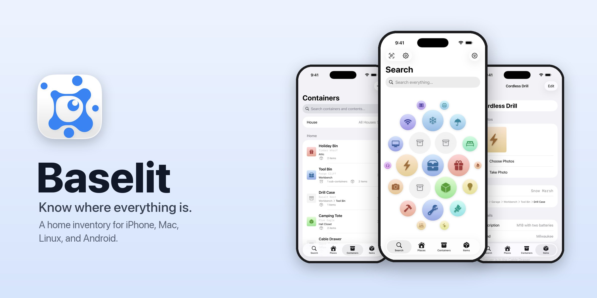
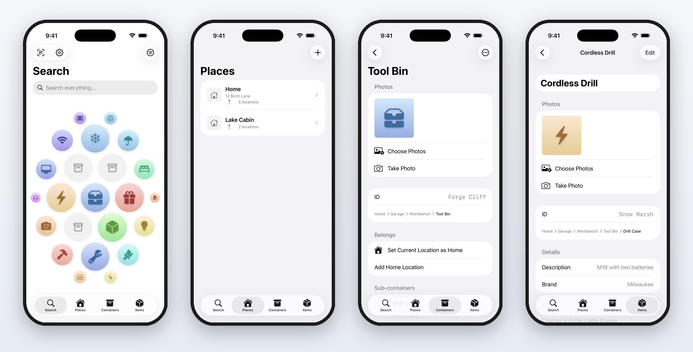
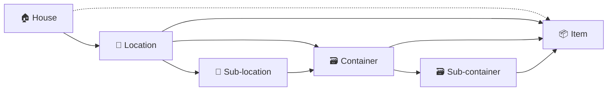
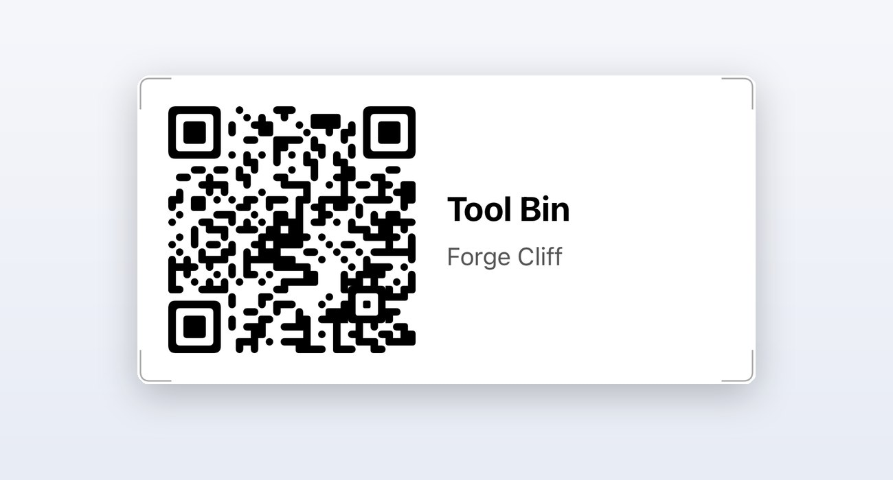
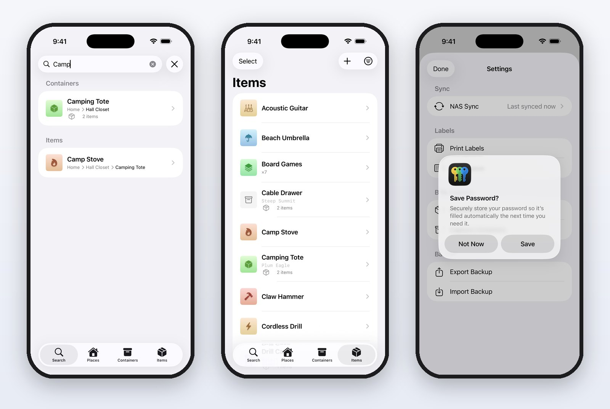
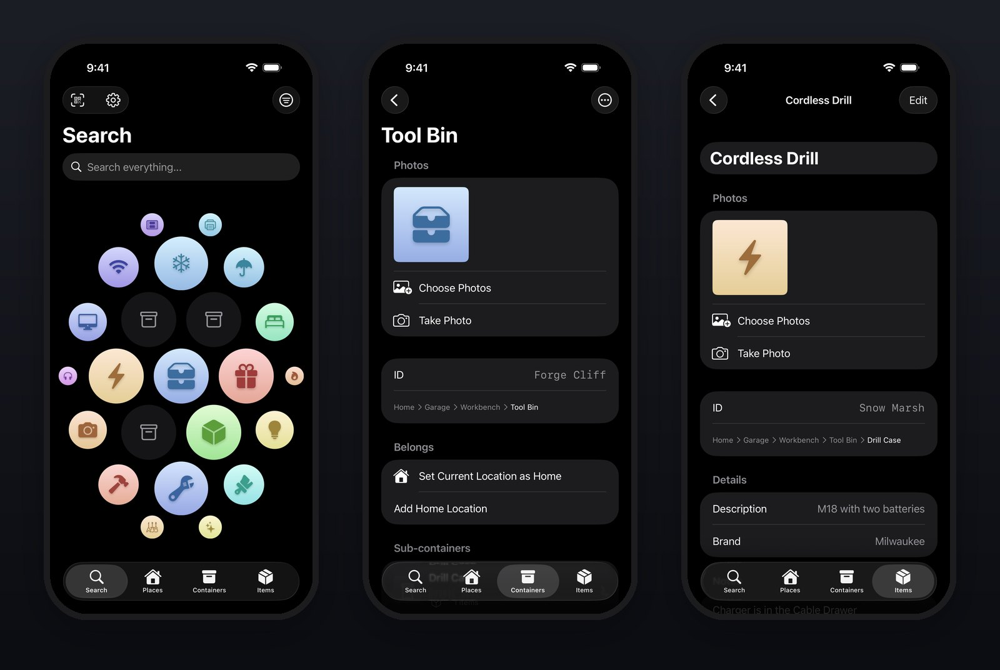
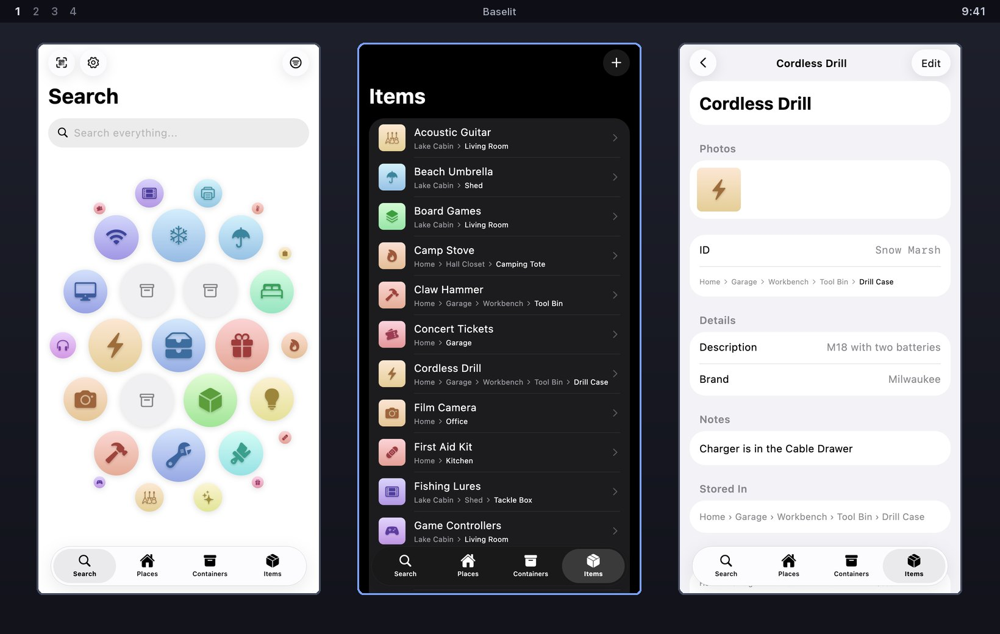
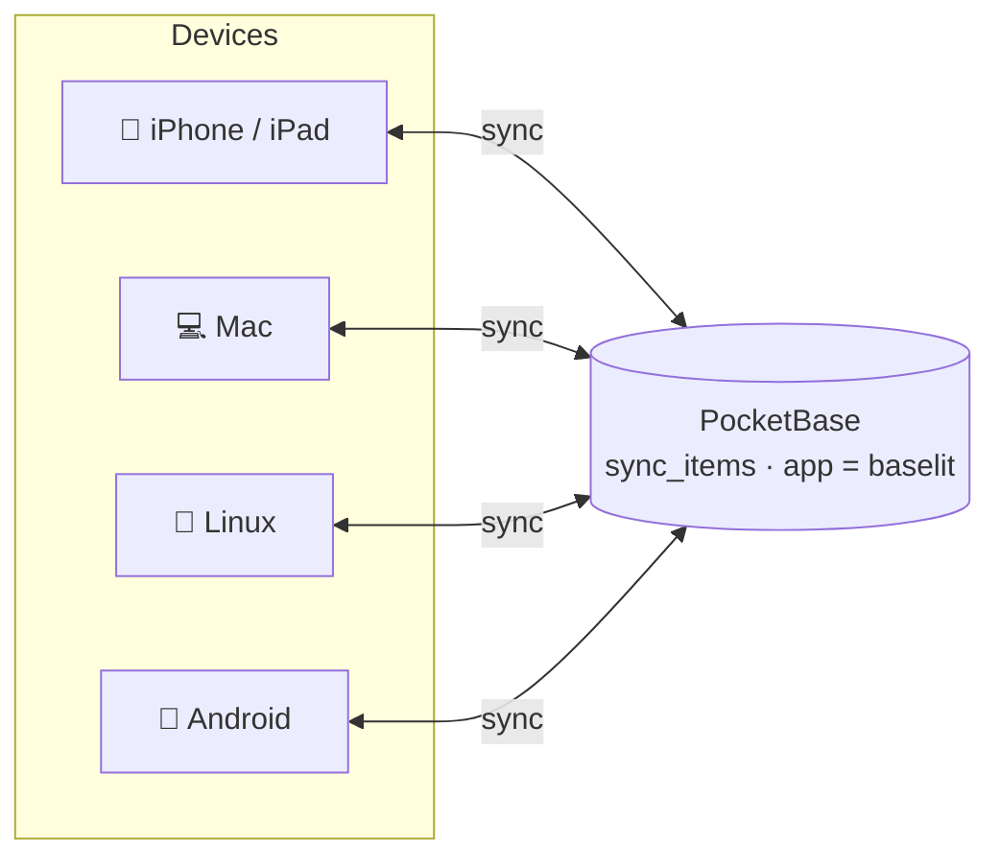
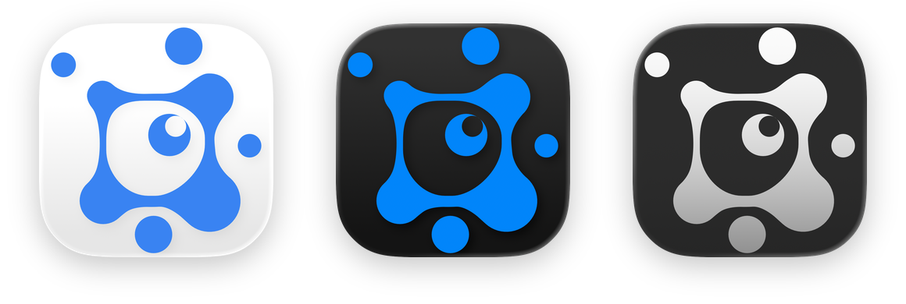

<p align="center">
  
</p>

<p align="center">
  <a href="#install"></a>
  <a href="#install"></a>
  <a href="#linux"></a>
  <a href="#android"></a>
  <a href="LICENSE"></a>
  <a href="https://github.com/jos-jason/Baselit/actions/workflows/flutter-linux.yml"></a>
</p>

**Baselit** is a home inventory for the things you own and the places you keep them.
Every item lives somewhere: a house, a room, a shelf, a bin inside a bin. Baselit
remembers where, shows you at a glance, and gets you back to anything with a search
or a scan of the label on the box.

It's a native SwiftUI app on iPhone, iPad, and Mac, with a companion Flutter app for
Linux and Android that looks and works the same way. Every copy can stay in sync,
photos included, through your own server.

<br>

## Features

### Everything at a glance

The Search tab opens on a honeycomb of everything you own, with your photos in the
bubbles. Drag to pan; bubbles shrink and gather toward the edges like the Apple Watch
home screen. Start typing and it becomes a search across houses, locations,
containers, and items, filtered by house if you like.

<p align="center">
  
</p>

### Places inside places

Houses hold locations, locations hold sub-locations and containers, and containers
nest as deep as your closets do. Every item and container shows its full path, so
"Cordless Drill" reads **Home › Garage › Workbench › Tool Bin › Drill Case**.



Each item can also have a **home** in every house: where it belongs when it's put
away. Baselit shows whether it's there right now, and one tap sets its current spot
as home.

### QR labels you can print

Every container and item gets a permanent two-word ID like **Forge Cliff**. Print a
label (one at a time, a whole sheet, or from a print queue), stick it on the bin, and
scanning it later jumps straight to that container from any Baselit app.

<p align="center">
  
</p>

### Fast to fill

**Bulk Capture** keeps the camera open so you can photograph a shelf's worth of items
one after another and sort out the details later. Photos, descriptions, brand, model,
condition, quantity, and notes are all searchable.

<p align="center">
  
</p>

### Light and dark

<p align="center">
  
</p>

<a id="linux"></a>

### On Linux and Android too

The Flutter app in [`baselit_flutter/`](baselit_flutter) keeps the iOS look: grouped
cards with soft corners, the floating tab bar, the bubble grid, and the same label
scanning (camera on Android and Mac, webcam on Linux, or from a photo anywhere).

<p align="center">
  
</p>

### Sync and backups

Every Baselit app can share one inventory through a self-hosted
[PocketBase](https://pocketbase.io) server, using the shared `sync_items` collection
from [nas-sync](https://github.com/jos-jason/nas-sync). Changes sync a few seconds
after you make them; if two devices change the same thing, the newer edit wins.



Without a server, **Export Backup** writes a `.zip` (a JSON file plus your photos)
that any Baselit app can import, so you can move an inventory between devices by hand.

<br>

## Install

| Platform | How |
| --- | --- |
| **iPhone, iPad** | Open `Baselit.xcodeproj` in Xcode 26 and run the **Baselit** scheme on your device. |
| **Mac** | Same scheme, with **My Mac (Mac Catalyst)** as the destination. |
| **Linux** | Download the latest build (below), or `flutter run -d linux` in `baselit_flutter/`. |
| **Android** | `flutter run -d android` in `baselit_flutter/` with a phone connected. |

### Linux (x64)

Every push to `main` that changes the Flutter app publishes a fresh build as the
[`linux-latest`](https://github.com/jos-jason/Baselit/releases/tag/linux-latest)
pre-release. It needs GTK 3, which desktops like Omarchy already have.

```bash
curl -LO https://github.com/jos-jason/Baselit/releases/download/linux-latest/baselit-linux-x64.tar.gz
tar -xzf baselit-linux-x64.tar.gz && cd baselit-linux-x64 && ./install.sh
```

Baselit then appears in your app launcher, or run `baselit`. Remove it with
`./install.sh --uninstall`; your inventory is kept.

<br>

## Project layout

```
Baselit/                 SwiftUI app for iPhone, iPad, and Mac (SwiftData)
├── Models/              House, Location, Container, Item, Photo, HomeLocation
├── Services/            Search, labels, backups, and NAS sync
└── Views/               Search, Places, Containers, Items, and Settings
baselit_flutter/         Flutter app for Linux and Android
├── lib/                 Store, screens, bubble grid, scanner, and sync
├── linux/packaging/     install.sh and the launcher icon
└── test/                Backup format, sync, QR, and screen previews
.github/workflows/       Linux build and release
```

<br>

## The icon

<p align="center">
  
</p>

<p align="center"><sub>The screenshots show made-up sample data.</sub></p>

## License

[MIT](LICENSE)
